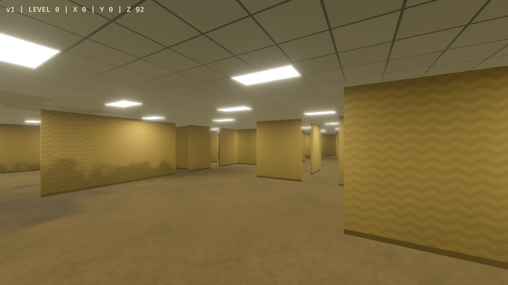
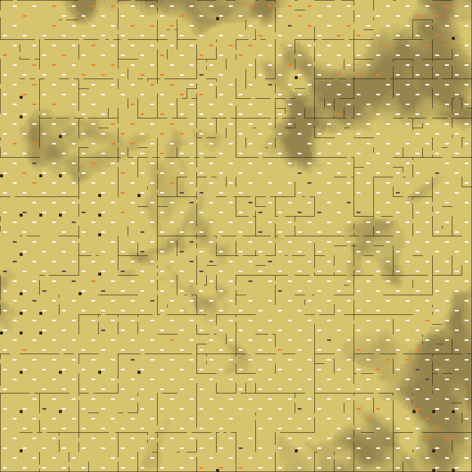

# Backrooms

A first-person exploration of the Backrooms in which the whole world is a
pure function of its coordinates: nothing is stored, and the same address is
the same place on every machine.

Current version: **0.2.0** (milestone 2 of 9: walkable Level 0). See
[CHANGELOG.md](CHANGELOG.md).



## Layout

| Crate | What it is |
|---|---|
| `crates/backrooms-core` | The world function. Integers only, no state, no dependencies, `no_std`. |
| `crates/backrooms-game` | The game: renderer, movement, lights and sound, on Bevy. |
| `crates/backrooms-cli` | `backrooms`, a headless tool for looking at the generated world. |

## Play

You need Rust 1.97.1 or newer (`rustup update`) and, on Linux, the libraries
Bevy links against. On Fedora:

```bash
sudo dnf install gcc pkgconf-pkg-config alsa-lib-devel systemd-devel wayland-devel libxkbcommon-devel
```

Then, from the repository:

```bash
cargo run --release -p backrooms-game
```

The first build compiles the engine and takes several minutes; later builds
take seconds.

| Input | Action |
|---|---|
| Click | Capture the mouse and look around |
| W A S D or arrows | Walk |
| Shift | Run |
| Escape | Release the mouse |

Where to start:

```bash
cargo run --release -p backrooms-game -- --address backrooms://v1/0/120000/-45000
```

```bash
cargo run --release -p backrooms-game -- --x 2000000000 --y -2000000000
```

```bash
cargo run --release -p backrooms-game -- --random
```

If it runs slowly, draw less far and use the cheaper lights:

```bash
cargo run --release -p backrooms-game -- --view 3 --lights point
```

`--help` lists everything, including `--size`, `--yaw`, `--pitch` and
`--screenshot <file.png>`, which saves one picture of the starting view and
quits.

## Look at the map

```bash
cargo run --release -p backrooms-cli -- map --chunks 32 --scale 6 --out map.png
```

```bash
cargo run --release -p backrooms-cli -- chunk --x 0 --y 0
```

```bash
cargo run --release -p backrooms-cli -- stack
```

Map legend: white lights are on, orange flicker, grey are dead; dark squares
are pillars; brown patches are damp carpet. One chunk is 16 x 16 cells, 8 m
on a side. `--chunks 512` draws 4 km x 4 km.



## Tests

```bash
cargo test --workspace
```

The golden test compares the generator with
`crates/backrooms-core/tests/golden/v1.txt`. While generator v1 is still a
draft, an intended change to the world is accepted with:

```bash
BACKROOMS_BLESS=1 cargo test -p backrooms-core --test golden
```

Once v1 ships, its output is frozen and that command is refused.
